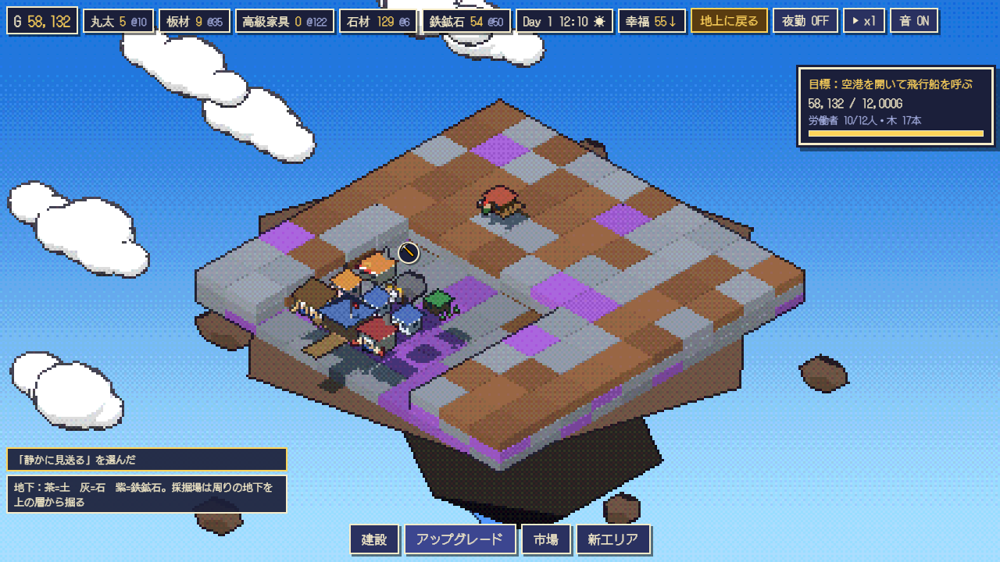

<p align="center"></p>

# ジオラマ・タウン・タイクーン（Diorama Town Tycoon）

**中身は3D、見た目はドット絵。** 空に浮かぶ小さな島で、木を伐り、施設を建て、住民に運ばせて街を育てます。街づくり × インクリメンタル × タイクーンのブラウザゲームです。

▶ **遊ぶ：https://sin1.studio/DioramaTownTycoon/**（インストール不要・PC／スマホ対応）

| 昼の島 | 地下（採掘場の断面） |
|---|---|
|  |  |
|  |  |

## 遊び方

1. **木や岩をクリック**して丸太・石材を集め、上のバーで売る
2. **木こり小屋**は2マス以内の木を伐り、丸太を**小屋に貯める**。小屋をクリックすると回収できる
3. **倉庫（市場）で運搬係を雇う**と、貯まった物を自動で運び、加工所へ材料も届けてくれる
4. 丸太(10G) → 板材(35G) → 高級家具(150G)。鉄の鉱脈を掘ると決めれば、鉄鉱石 → 鉄インゴット → 歯車・機械(800G)
5. 岩はいつか尽きる。**採掘場**を建てると地下を掘れる（「地下を見る」で断面が見えて、鉄の鉱脈も探せる）
6. **12,000Gで空港を開く**と飛行船がやってきて、島の歩みに応じた**称号**が決まる

| 操作 | PC | スマホ |
|---|---|---|
| 回転 | ドラッグ / ←→・A D | 1本指ドラッグ |
| ズーム | ホイール / ↑↓・W S | ピンチ |
| 伐採・回収・選択 | クリック | タップ |
| 建設の中止 | 右クリック / Esc | — |

最初の**チュートリアル**（8ステップ）だけは一本道です。スキップもできます。

## 自分だけの島になっていく

- **置き場所が効いてくる**：木こり小屋は森の近く、加工所は倉庫の近く（運搬が速い）に置くと有利です。製材所と家具工房を隣に置くと速度+30%。家の近くでは住民の移動が+25%。ただし工場の隣の家は騒音で幸福度が下がります
- **道ができる**：住民がよく通るマスは土の道になります。「石畳の道」を取ると舗装されて速く歩けます
- **島を広げる**：東西南北に1列ずつ広げられます（最大12×12）
- **島の住人**：うさぎ（森が減ると姿を消す）、ひつじ、ねこ、小鳥がいます。クリックすると反応します
- **空**：昼夜サイクルがあります。夜空にはオリオン座・北斗七星・カシオペヤ座・夏の大三角・さそり座・すばるの並びを元にした星が出て、ときどき流れ星も見えます

## 正解のないジレンマ

チュートリアルが終わると、毎朝「島の相談ごと」が届きます。どれもイラストつきです。選んだ結果もイラストつきのカードで見られます。

- **鉄の鉱脈**：掘る／聖地として守る
- **島の進む道**：蒸気機関／職人の誇り／森と共に
- **雲クジラ**：お金を出して宴でもてなすと、恵みの雨で苗木が一斉に育つ
- **浮遊石のひび**：石材で直すか、賭けて様子を見るか（外れると島が揺れる）
- **空賊**：通行料を払うか、追い返すことに賭けるか
- **気球の旅人**：板材と「金の木」の苗を交換するか
- **流れ星の夜**：夜勤を休んでみんなで願い事をするか
- **収穫祭**：開くと夜に広場で踊りと花火。**夜勤**：稼げるが住民が疲れる
- ほかに大口注文、嵐、投資家、森の保護、職人一家、ライバル島など

称号は「森と共に生きる島」「煙突と歯車の都」「名工の里」「商いの港町」「笑顔あふれる村」「眠らない島」の6種類です。選択によって変わります。

## 技術メモ

- 単一の `index.html`。Three.js r160（jsDelivr）だけを読み込み、3Dモデル・効果音（WebAudio）はすべてコード内で生成しています
- **ドット絵化パイプライン**：画面の1/3解像度（スマホは1/2）の `WebGLRenderTarget` に描画 → 全画面シェーダーで深度差からアウトラインを描き、ポスタライズとベイヤーディザをかけて拡大表示しています。輪郭の閾値は1ドットあたりの世界サイズに合わせて変わります。シェーディングは `MeshToonMaterial` の3段階グラデーションです
- 点光源は起動時に固定数を用意し、強さだけを変えています（夕暮れにシェーダーの再コンパイルが起きないように）
- 調整用の数値はファイル冒頭の `P` / `ITEMS` / `BUILD` にまとめています。進行状況は `localStorage` に自動で保存されます
- ロゴとイベントのイラストは Google Gemini で生成しました
- ゲームデザインは [sakurai-skill](https://github.com/kociden/sakurai-skill)（桜井政博氏の動画の要約スキル）の原則を参考にしました

## ローカルで動かす

```
python -m http.server 8000
# → http://localhost:8000/
```

`?debug` を付けると、速度に x20 が追加され、F8 で資金を増やせます。

## ライセンス

コードは MIT です。
