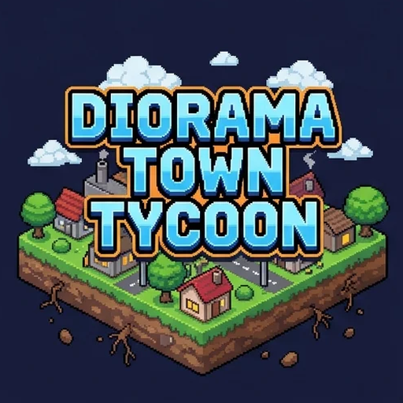
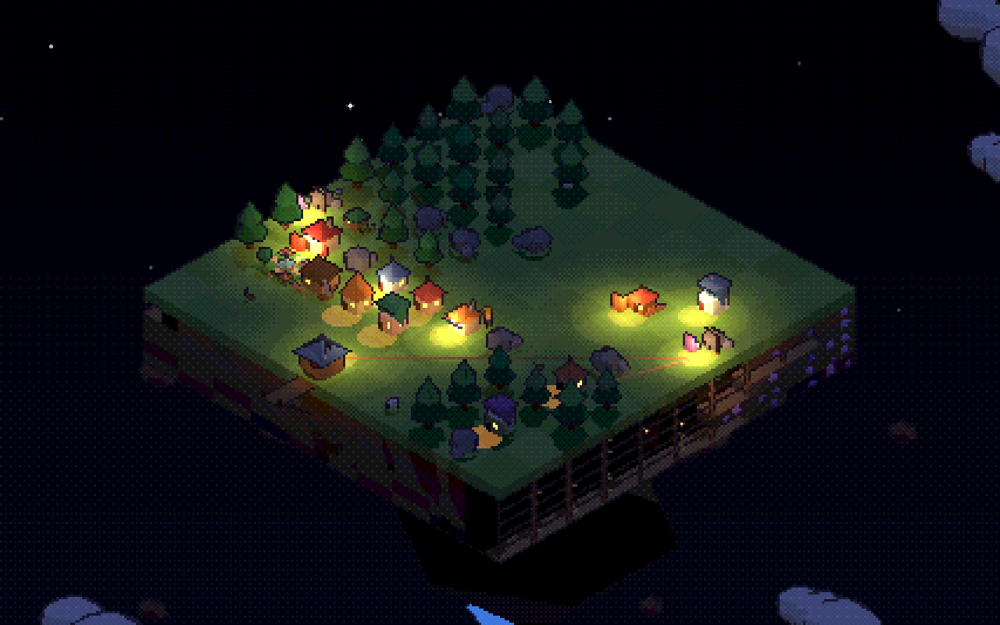
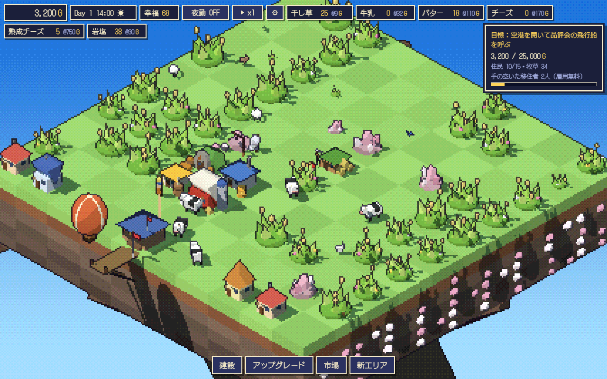
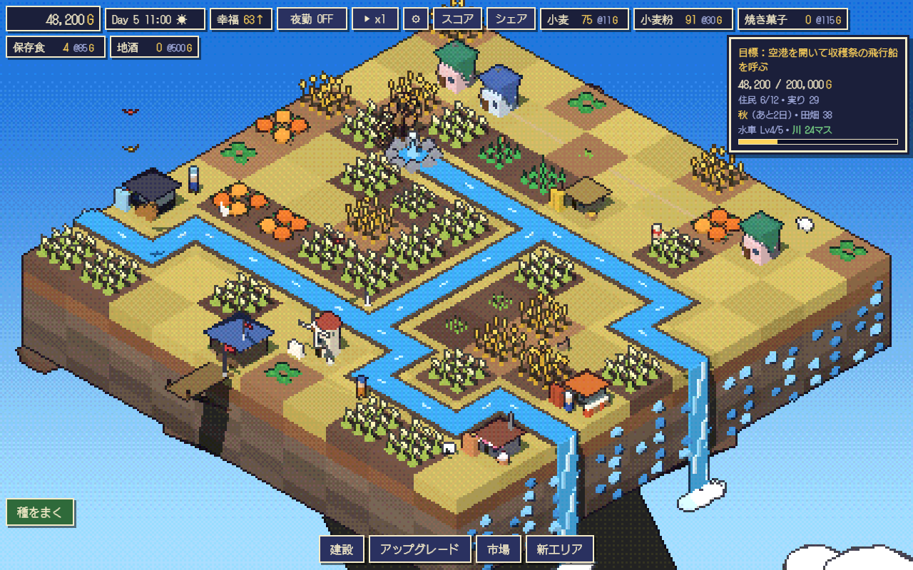
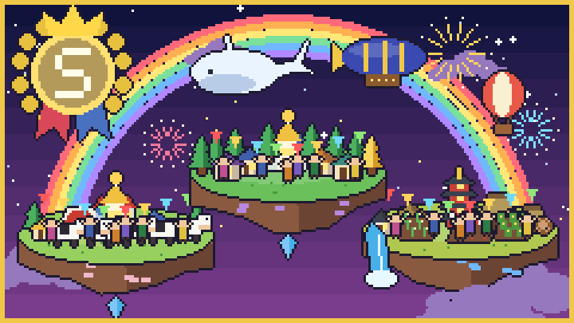

# ジオラマアイランド / Diorama Island

**中身は3D、見た目はドット絵。** 空に浮かぶ小さな島で木を伐り、施設を建て、住民に運ばせて街を育てます。街づくり × インクリメンタル × タイクーンのブラウザゲームです。日本語と英語に対応しています。

*A 3D world rendered as pixel art. Grow a floating island town — chop, build, haul and trade. Japanese / English.*

▶ **遊ぶ / Play: https://sin1.studio/diorama/**（インストール不要・PC／スマホ対応）

| 昼の島 | 夜（収穫祭） |
|---|---|
|  |  |

| 2つめの島：酪農の島 |
|---|
|  |

| 3つめの島：農耕の島（秋） |
|---|
|  |

## 遊び方

1. **木や岩をクリック**して丸太・鉄鉱石を集め、交易気球の商人に売る
2. **木こり小屋**は近くの木を伐り、丸太を**小屋に貯める**。小屋をタップすると回収できる
3. **市場で運搬係を雇う**と自動化できる。できた物は**次の加工所へ直接**運ばれ、余った分は市場に届く
4. 丸太 → 板材 → 高級家具。鉄鉱石 → 鉄インゴット → 歯車
5. 地上の岩はいつか尽きる。坑道を開くと、採掘場が地下の鉄鉱石を掘る（量は多いが無限ではない）。桟橋の両隣の崖は**断面図**になっていて、坑道・残りの鉱石・働く鉱夫が見える
6. **12,000Gで空港を開く**と、桟橋の場所に空港ができて飛行船がやってくる。島の歩みに応じた**称号**が決まる
7. そのあとは**飛行船の改装**と**『空の遊園地』**で観光客を呼べる（朝の飛行船で来て、夕方に帰る）
8. 空港から**酪農の島**へ渡れる。**お金も住民も持ちこさず、350G・住民0人から**始める

| 操作 | PC | スマホ |
|---|---|---|
| 回転 | 左ドラッグ / ←→ | 2本指をひねる・⟲⟳ボタン |
| 移動 | 右ドラッグ | 1本指ドラッグ |
| ズーム | ホイール | ピンチ |
| 建てる・移す | クリック | タップ → ✓で決定 |

最初の**チュートリアル**（8ステップ）だけは一本道です。スキップもできます。

## 自分だけの島になっていく

- **置き場所**：持ち場から遠い仕事ほど、急に効率が落ちます。木こり小屋は森のそば、加工所は市場のそばに置くと有利です
- **移動**：建物は10Gで、少し時間をかければいつでも動かせます
- **道ができる**：よく通るルートほど濃い道になり、使われなくなると薄れて消えます。となり合う同じ種類の建物は入口が1つにまとまり、離れた同じ種類の建物どうしも道でつながって散歩する人が行き来します（家は夜、ほかは昼）
- **運ぶ道具**：丈夫な背負子 → 人力車 → 馬車（見た目も変わります）
- **道の改良**：石畳の道 → 街灯のある道（夜の作業と移動 +30%）
- **経営方針**：優良経営 → ブラック経営 → 社畜の島。幸福を削るほど作業と売値が上がります（1日1回変更可）
- **暮らし**：住民は暗くなる前に家に帰ります。家が遠いと、そのぶん早く仕事を切り上げます
- **暮らしの建物**：パン屋・花の公園（2×2マス）・浴場（夜勤の疲れが半分になる）
- **鉄**：一部の建物は鉄鉱石やインゴットも使います。リサイクル工場ならガラクタから鉄鉱石を取り出せます
- **働く人**：加工の仕事は建物の中。ときどき荷物を抱えて外へ用事に出ます
- **家の見た目**：屋根の形（5G）・壁の色・屋根の色（各2G）を選べます
- **救済**：緑が尽きると翌朝に少し生えます（お金も尽きていれば、すぐ使える大きさで）。お金がなくて修理できない建物は、住民が1日1棟直してくれます
- **島を広げる**：東西南北に1列ずつ広げられます
- **空と住人**：交易気球、遠くを漂う気球、雲クジラ、うさぎ・ひつじ・ねこ・小鳥がいます。夜空には実在の星座をもとにした星が出て、流れ星も流れます
- **となりの島**：ズームアウトすると遠くに見えます。空港を開くと次の島へ渡れます（空 → 酪農 → 農耕）

## 酪農の島：放牧

この島では、牛が自分で草を食べに行きます。プレイヤーは**鐘**で群れを導きます。

1. 鐘のまわり5×5マスの草を牛が食べ、乳が張ると牛舎へ帰ります（**タップでも搾れます**）
2. 輪の中では草が生えません。**鐘を移して休ませると、食べ跡がクローバー**になり、乳が2倍濃くなります
3. 草のない場所に居座ると**泥地**になり、しばらく生えません

| 建物 | はたらき | 建設に使う岩塩 |
|---|---|---|
| 草刈り小屋 | 牧草 → 干し草（夜と草不足のときのエサ） | - |
| 岩塩場 | 岩塩を割って貯める | - |
| 種まき小屋 | 牧草の種をまく | - |
| 牛舎 | 帰ってきた牛を搾る・牛を増やす | - |
| バター小屋 | 牛乳 → バター | 5 |
| チーズ工房 | 牛乳 → チーズ | 15 |
| 熟成蔵 | チーズ → 熟成チーズ | 25 |

- 「改良」の**牧羊犬**は、草がなくなると鐘を近くの草地へ運びます
- 牛の品種、牧場の方針、子牛、旅の食通など、この島だけの相談ごとと称号があります
- 目標は140,000Gで空港を開き、品評会の飛行船を呼ぶことです（空の島より手強い）
- 救済：お金も草もなくなると、長老が鐘を運んでくれます
- 島はそれぞれ残ります。行き来しても消えません（留守のあいだ時間は止まります）

## 出荷の記録とシェア
- スコア画面に総出荷量が出ます（例：地酒 1,035本＝家の風呂3.7杯ぶんぐらい）
- シェア画像は育てた島の写真が主役。Xへは、スマホは共有ボタンで画像つき、PCはコピーされた画像を貼り付け

## 農耕の島：川と四季

1. **空き地をタップ**すると種をまけます（建設の「田畑」からでも）
2. **湧き水か川をタップ**して揚水水車を上げると、1Lvごとに**川を3マス、好きな所に敷けます**（はがして敷き直し可・おまかせ可）。島の端で終われば滝。上限はLv5で、**島を広げるたびに+1**
3. 夏は川の先の1/4が干上がります
4. **道になっている所の田畑は踏まれて育ちが悪く**なります（種まき中は赤く表示）
5. 季節は2日ずつ。**冬は植えられず、何も育たない**ので、秋に貯めて加工でしのぎます

| 作物 | 好きな土 | 得意な季節 | 加工 |
|---|---|---|---|
| 小麦 | 乾いた土（水ぎわは苦手） | 春・秋 | 風車 → 小麦粉 → 菓子工房 → 焼き菓子 |
| 稲 | 流れている川のとなり | 夏 | 酒蔵 → 地酒 |
| かぼちゃ | 違う作物のとなり | 秋 | 保存食の蔵 → 保存食 |

- 目標は200,000G。3島でいちばん手強い島です
- 救済：お金も実りもなくなると、長老が育った苗を分けてくれます

## スコア

上の**「スコア」**から、いつでも島ごと（1,000点）と3島の総合（3,000点）を見られます。ランクは S・A・B・C・D で、ランクごとに島の育ったイラストが変わります。

| 項目 | 満点 | 上げ方 |
|---|--:|---|
| 開拓 | 250 | 空港を開く |
| 速さ | 250 | 空港を早く開く |
| 幸福 | 200 | 平均幸福を高く保つ |
| にぎわい | 150 | 建物の種類と住民を増やす |
| その島ならでは | 150 | 空：森づくり／酪農：放牧／農耕：川と田畑 |

## シェア

- 上の**「シェア」**から島に名前をつけ、**絵はがき**（島の写真・称号・看板牛）を保存・コピー・共有できます
- **訪問リンク**を開いた人は、その島を見て回れます。島の形はURLに入っているのでサーバーは使わず、訪問した人のセーブにも影響しません
- **Xにポスト**は投稿画面を開くだけです。投稿するかは自分で決められます。投稿には**ランクのイラストがカードとして表示**されます（`r/` の中継ページ）

## セーブ

- 自動で保存します（10秒ごと・画面を離れたとき）
- 毎朝の状態（島ごとに3日ぶん）と、やり直し・島の移動の直前の状態を、タイトル画面か設定の**「前のセーブに戻す」**から戻せます
- 複数のタブで開いたときは、最後に開いたタブが保存します

## 正解のないジレンマ

毎朝「島の相談ごと」が届きます。どれもイラストつきで、結果（成功・失敗）もイラストで出ます。鉄の鉱脈、島の進む道、雲クジラ、浮遊石のひび、空賊、気球の旅人、流れ星の夜、眠れる大鉱脈、収穫祭、嵐、大口注文、上機嫌の住民・不満の声、夜明けの特急便（夜勤）などがあります。借金や注文の条件は毎回少しずつ違い、お得なときも損なときもあります。進行中の注文や返済は、画面上部のバーで達成率と期日までの残り時間がわかります。

称号は6種類あり、選び方によって変わります。

## 設定（⚙）

言語（日本語／English）、建物アイコン（自動＝チュートリアル中だけ／いつも／注意だけ／なし）、注意の矢印（壊れた・人がいない・満杯の建物）、音、ドットの粗さ、画面の揺れ、影、文字の大きさを変えられます。

## 技術メモ

- `index.html` と `game.js` だけで動きます。読み込むのは Three.js r160（jsDelivr）のみで、3Dモデルと効果音はすべてコードで生成しています
- 描画は低解像度 → 深度で輪郭を描く → ポスタライズとディザ → 拡大、という流れです。点光源は数を固定して、強さだけを変えています
- ロゴとイベントのイラストは Google Gemini で生成しました（酪農の島の牛や牧場の場面は、ゲーム内の画面から作成）
- ゲームデザインは [sakurai-skill](https://github.com/kociden/sakurai-skill) を参考にしました

## ライセンス

コードは MIT です。
