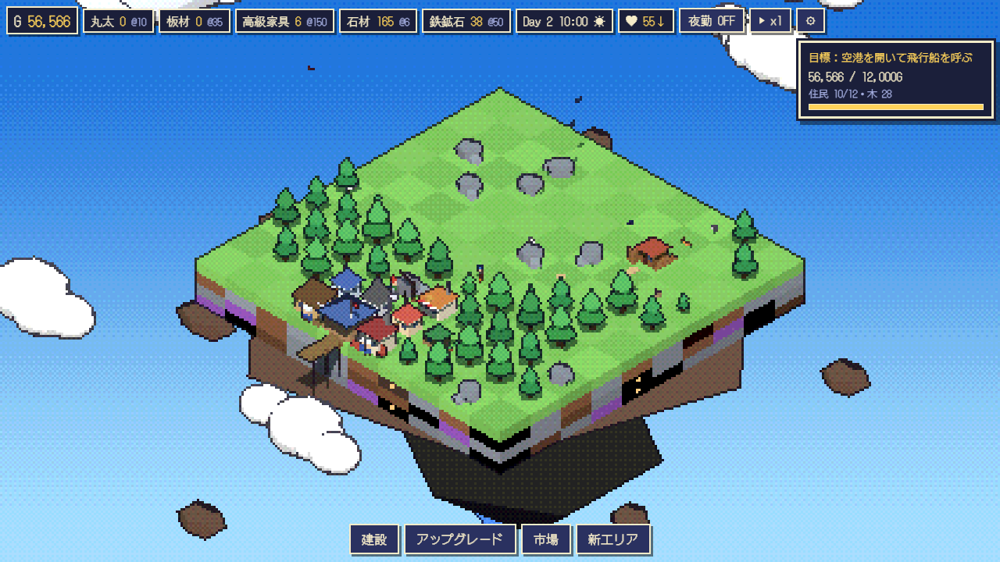
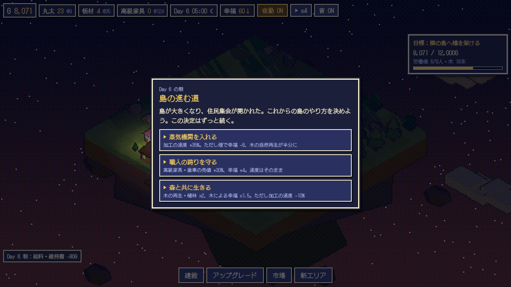
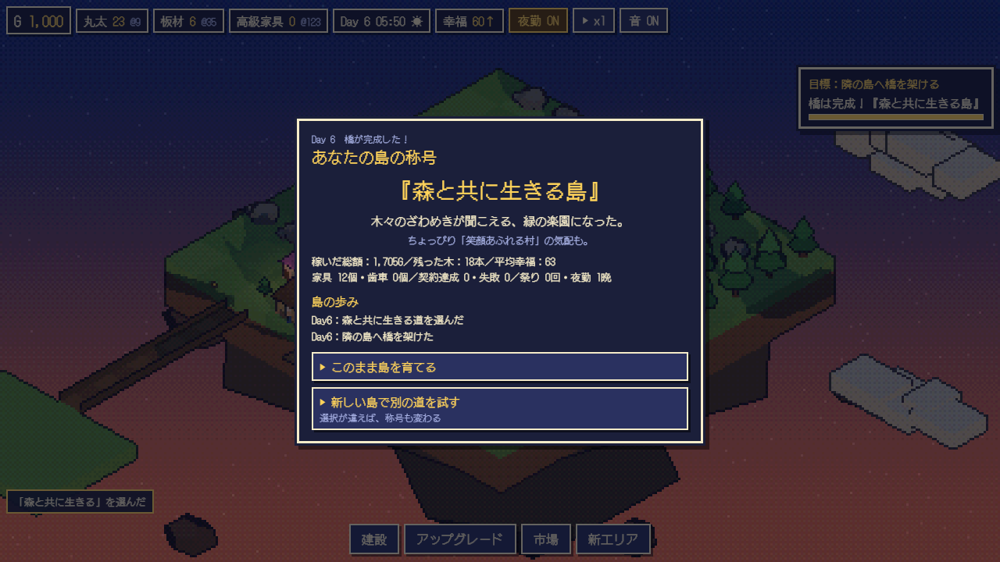

<p align="center"></p>

# ジオラマ・タウン・タイクーン（Diorama Town Tycoon）

**中身は3D、見た目はドット絵。** 浮かぶ10×10マスの小さな島で、木を伐り、施設を建て、住民に運ばせて街を育てる街づくり × インクリメンタル × タイクーンのブラウザゲームです。

▶ **遊ぶ：https://sin1.studio/DioramaTownTycoon/**（インストール不要・PC／スマホ対応）

| 昼 | 夜 |
|---|---|
|  |  |
|  |  |

## 遊び方

1. **木や岩をクリック**して丸太・石材を集め、上のバーで売る
2. **建設**から木こり小屋・製材所・家具工房を建て、施設をクリックして**住民を雇う**
3. 住民が自動で伐採・運搬・加工する。丸太(10G) → 板材(35G) → 高級家具(150G)
4. 3日目ごろ、鉄のチェーン（鉄鉱石 → 鉄インゴット → 歯車・機械 800G）を解放するかどうか選ぶ
5. **12,000G で隣の島へ橋を架ける**と、あなたの島の歩みに応じた**称号**が決まる

| 操作 | PC | スマホ |
|---|---|---|
| 回転 | ドラッグ / ←→・A D | 1本指ドラッグ |
| ズーム | ホイール / ↑↓・W S | ピンチ |
| 伐採・選択 | クリック | タップ |
| 建設の中止 | 右クリック / Esc | — |

最初の**チュートリアル**（6ステップ・約2〜3分）だけは一本道です。スキップもできます。

## 正解のないジレンマ

チュートリアルが終わると、毎朝「島の相談ごと」が届きます。どれも、そのときの所持金・幸福度・木の数・生産力によって正解が変わるように作ってあります。

- **鉄の鉱脈**：掘れば高単価の鉄チェーンが開く（ただし岩は有限で、石材と取り合いになる）。聖地として守れば、幸福度と石材にずっとボーナスがつく
- **島の進む道**：蒸気機関（速いが煙と森の衰え）／職人の誇り（高く売れる）／森と共に（再生は速いが加工は遅い）から選ぶ
- **大口の注文**：期限内に作れれば2倍以上の報酬。間に合わなければ違約金
- **嵐**：補強費を払うか、賭けに出るか
- **夜勤**：夜も稼げる代わりに幸福度が下がる。続けると住民が休みを求めてくる

配置にもトレードオフがあります。製材所と家具工房を隣に置くと速度+30%、家の近くでは住民の移動が+25%。一方で、工場の隣の家は騒音で幸福度が下がります。木を伐れば土地は空きますが、森は減り、幸福度も下がります。

称号は「森と共に生きる島」「煙突と歯車の都」「名工の里」「商いの港町」「笑顔あふれる村」「眠らない島」の6種類です。選択によって変わります。

## 技術メモ

- 単一の `index.html`。Three.js r160（jsDelivr）だけを読み込み、3Dモデル・効果音（WebAudio）はすべてコード内で生成しています
- **ドット絵化パイプライン**：画面の1/3解像度の `WebGLRenderTarget`（`NearestFilter`、深度テクスチャ付き）に描画 → 全画面シェーダーで深度差からアウトラインを描き、ポスタライズとベイヤーディザをかけて拡大表示しています。シェーディングは `MeshToonMaterial` の3段階グラデーションです
- **昼夜サイクル**：太陽の角度と色、空のグラデーション、星を時刻に合わせて変えています。夜は窓や炉の発光マテリアルと点光源が灯ります。点光源は起動時に8個を固定で用意し、強さだけを変えるので、夕暮れにシェーダーの再コンパイルが起きません
- 調整用の数値はファイル冒頭の `P` / `ITEMS` / `BUILD` にまとめています
- 進行状況は `localStorage` に自動で保存されます
- ゲームデザインは [sakurai-skill](https://github.com/kociden/sakurai-skill)（桜井政博氏の動画の要約スキル）の原則（リスクとリターン、最初の3分、チュートリアルは本編の形で、手応え＝ヒットストップと潰し）を参考にしました

## ローカルで動かす

```
python -m http.server 8000
# → http://localhost:8000/
```

`?debug` を付けると、速度に x20 が追加され、F8 で資金を増やせます。

## ライセンス

MIT
